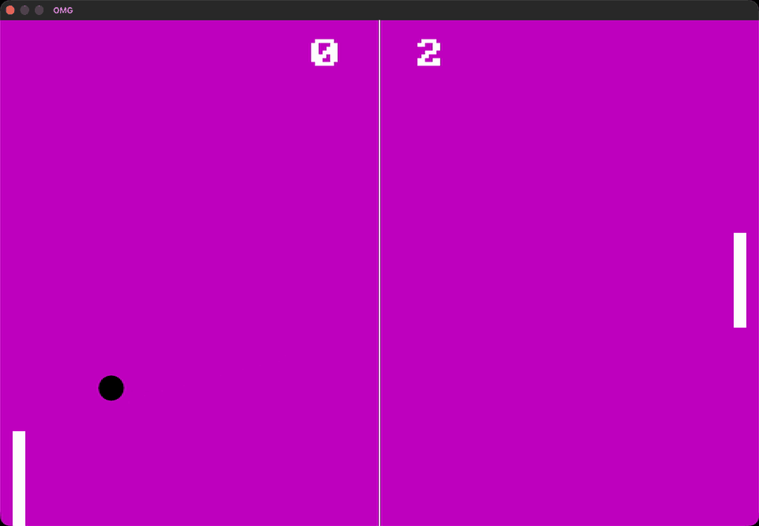

# MacEngine

A small 2D game framework for macOS, written in C++ and rendered with Metal.



> **Status:** 0.1, early release. macOS only. The API may still change.

## Features

- Window management (resizable, title, custom icon)
- 2D shapes: rectangles, circles, lines, polygons
- Textures: load PNG/JPG, draw with rotation, scale, flipping and source rects
- Text rendering with a built-in bitmap font (UTF-8, accented letters)
- 2D camera with zoom and rotation
- Keyboard input by key label (`IsKeyDown`) or physical position (`IsPhysicalKeyDown`)
- Mouse input: buttons, position, delta, scroll
- Native macOS menu bar
- Delta time, FPS counter, target FPS
- MSAA antialiasing

## Not yet

- Audio (planned)
- Gamepad support
- Text input
- Windows / Linux (planned)

## Requirements

- macOS 13 or newer (Apple Silicon or Intel)
- Xcode Command Line Tools (`xcode-select --install`)
- CMake 3.20 or newer
- A C++20 compiler (Apple Clang)

## Installation

### Option 1: Installer (easiest)

1. Download `MacEngine-0.1.0.pkg` from the [latest release](https://github.com/xGetrey/MacEngine/releases/latest).
2. Double-click it and follow the steps.

The installer is not signed yet, so macOS may block it the first time. If you see a message that it "can't be opened":

1. Open **System Settings → Privacy & Security**.
2. Scroll down and click **Open Anyway** next to the MacEngine message.
3. Double-click the installer again.

### Option 2: ZIP

Download `MacEngine-0.1.0.zip` from the [latest release](https://github.com/xGetrey/MacEngine/releases/latest). It contains the `include` and `lib` folders. Copy them wherever you like and point CMake to that folder with `-DCMAKE_PREFIX_PATH=/path/to/MacEngine-0.1.0`.

### Option 3: Build from source

```sh
git clone https://github.com/xGetrey/MacEngine.git
cd MacEngine
cmake -S . -B build -DCMAKE_BUILD_TYPE=Release
cmake --build build
sudo cmake --install build
```

Options 1 and 3 install MacEngine to `/usr/local`:

| Path | Content |
| --- | --- |
| `/usr/local/lib/libMacEngine.a` | The library |
| `/usr/local/include/MacEngine/` | Header files |
| `/usr/local/lib/cmake/MacEngine/` | Files for CMake `find_package` |

## Usage

`CMakeLists.txt`:

```cmake
cmake_minimum_required(VERSION 3.20)
project(MyGame)

set(CMAKE_CXX_STANDARD 20)

find_package(MacEngine REQUIRED)

add_executable(MyGame main.cpp)
target_link_libraries(MyGame PRIVATE MacEngine::MacEngine)
```

`main.cpp`:

```cpp
#include <MacEngine/MacEngine.h>

using namespace Engine;

int main() {
    Window window = Window(800, 600, "My Game");

    Vector2 pos = Vector2(400.0f, 300.0f);

    while (!window.ShouldClose()) {
        window.PollEvents();

        if (IsPhysicalKeyDown(Key::A)) pos.x -= 300.0f * GetDeltaTime();
        if (IsPhysicalKeyDown(Key::D)) pos.x += 300.0f * GetDeltaTime();

        BeginDraw();
        DrawCircle(pos, 30.0f, Color(255, 200, 0, 255));
        DrawText("Move with A / D", {20.0f, 20.0f}, 24.0f, Color(255, 255, 255, 255));
        EndDraw();
    }

    return 0;
}
```

Build and run it:

```sh
cmake -S . -B build
cmake --build build
./build/MyGame
```

## Uninstall

```sh
sudo rm -rf /usr/local/include/MacEngine /usr/local/lib/cmake/MacEngine /usr/local/lib/libMacEngine.a
sudo pkgutil --forget io.github.xgetrey.macengine.MacEngine
```

The second line is only needed if you used the installer.

## Roadmap

- **0.2**: audio, text input
- **Later**: gamepad support, Windows support

## Feedback

Found a bug or have an idea? Please open an [issue](https://github.com/xGetrey/MacEngine/issues).

## Credits

- Built-in font: [font8x8](https://github.com/dhepper/font8x8) by Daniel Hepper (public domain)

## License

MacEngine is licensed under the [zlib License](LICENSE).
